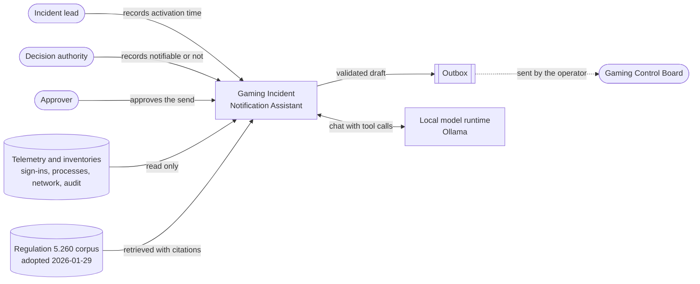
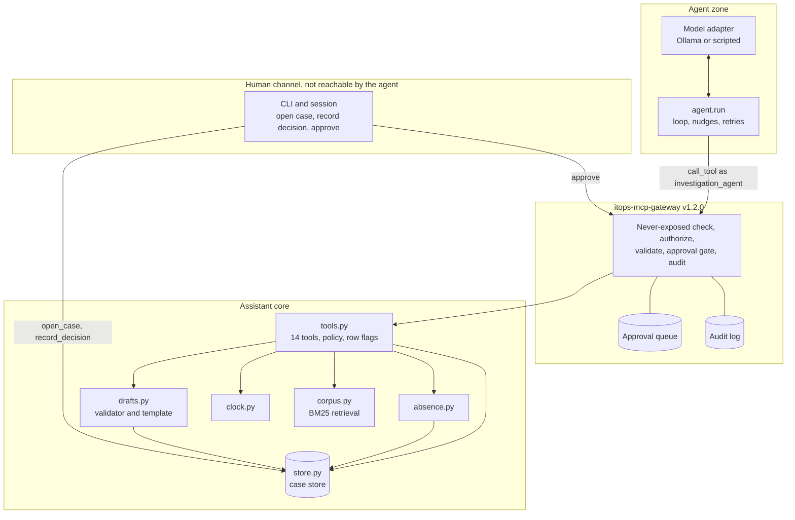
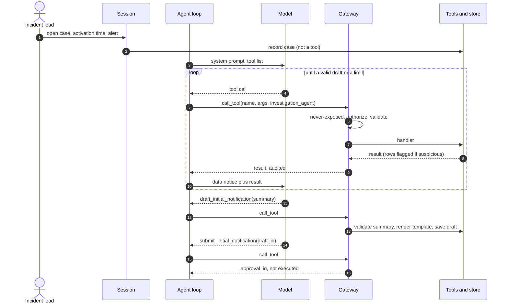
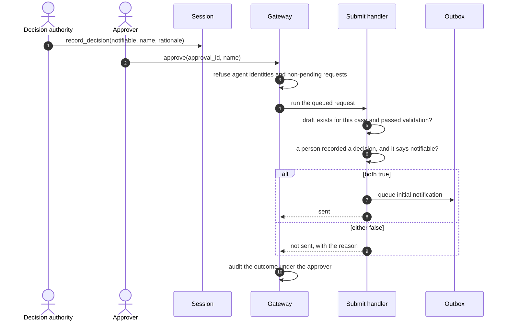
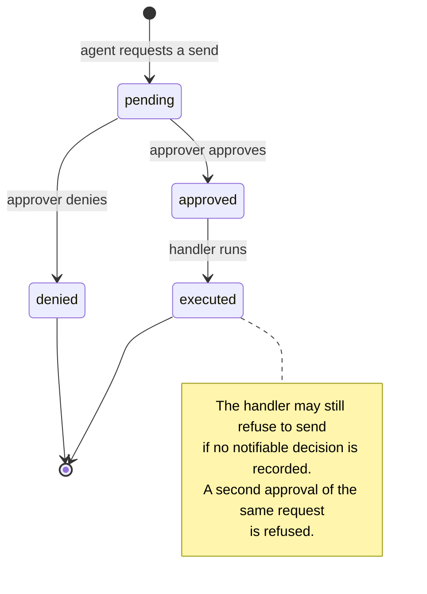
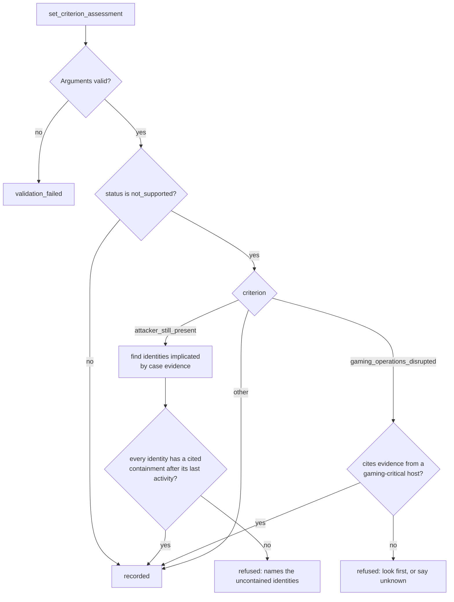
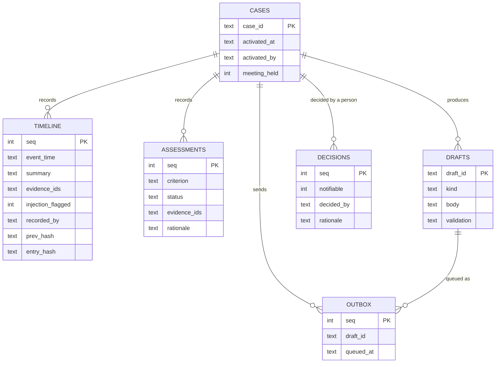
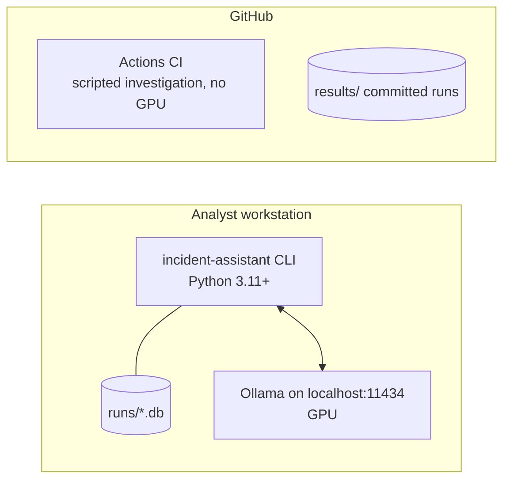
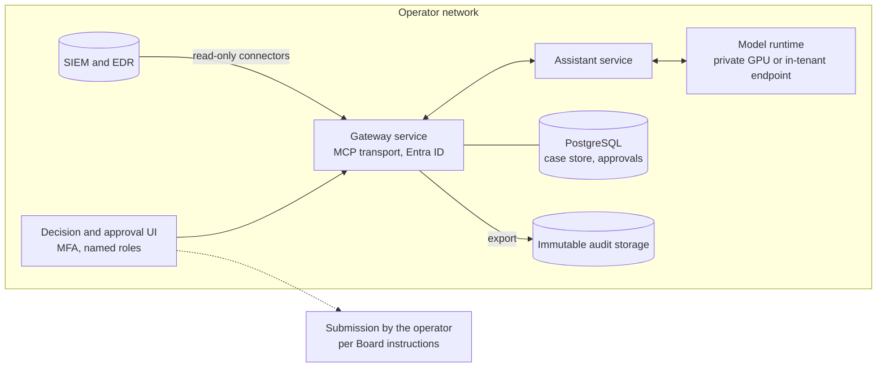
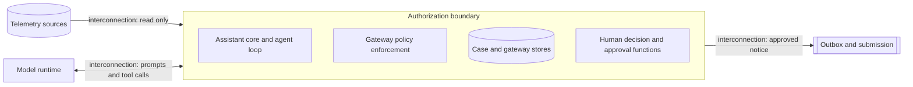

# Architecture

Version 1.0, 2026-11-07.

The architecture is described from several viewpoints, because each audience asks a
different question. An executive asks why it exists and what it costs to get wrong. An
assessor asks where the boundary is and what controls sit on it. An engineer asks which
module owns which rule. The sections answer those in turn.

| Section | Viewpoint | Answers |
|---|---|---|
| 2 | Zachman Framework | The complete picture: six questions from six perspectives |
| 3 | Context | What the system touches, and who |
| 4 | Logical components | Which module owns which responsibility |
| 5 | Process | How a case moves, and how a send is gated |
| 6 | Information | What is stored, where, and how it is protected |
| 7 | Deployment | What runs where today, and the target |
| 8 | Risk Management Framework | The authorization boundary and categorization |
| 9 | Decisions | The choices that shape everything above |

The security view is in [SECURITY.md](SECURITY.md). Requirements and their verification
are in [REQUIREMENTS.md](REQUIREMENTS.md).

---

## 1. Principles

These five rules explain most of the structure below.

1. **An agent only where the path cannot be known in advance.** Investigation branches on
   what each query returns, so it is agentic. Deadlines, report format, citation checks
   and authorization are ordinary code.
2. **Decisions with legal weight belong to named people.** The activation time, whether
   to notify, and whether to send are recorded by people through functions that are not
   tools.
3. **Defenses are structural, not persuasive.** The agent is not asked to behave; it is
   given no tool whose misuse matters. A successful prompt injection can produce a wrong
   draft and nothing else.
4. **Evidence before prose.** A fact enters the record with an evidence ID before any
   sentence may state it, and the regulation is retrieved before it is cited.
5. **Absence is a claim.** "The attacker is gone" and "gaming was not affected" need
   positive evidence. Not knowing is always an acceptable answer.

---

## 2. Zachman Framework view

The Zachman Framework classifies architecture descriptions by six interrogatives
(columns) and six perspectives (rows). Each cell is a single model of the system. Rows
are not levels of detail of one model; each is a different audience's complete view.

### 2.1 The matrix

| Perspective | What (inventory) | How (process) | Where (distribution) | Who (responsibility) | When (timing) | Why (motivation) |
|---|---|---|---|---|---|---|
| **Executive** (scope) | Incident facts, the regulator notice, the evidence record | Investigate, assess, draft, decide, notify | The operator's environment; the Board as an external recipient | Incident lead, decision authority, approver, the Board | Activation starts the 24-hour, 5-day and 30-day clocks | Meet Regulation 5.260 without trading accuracy for speed |
| **Business** (concepts) | Case, alert, evidence item, timeline entry, assessment, draft, decision, approval | Open, investigate, assess, draft, decide, approve, send | Security operations; gaming-critical systems; hotel and loyalty systems | The agent investigates and drafts. People decide and approve | Deadlines run from activation; updates run from the initial notification | Unknown is never no. Absence needs evidence. Sending takes two human acts |
| **Architect** (logic) | Case store schema; regulation corpus sections; gateway audit and approval records | 14 tools in three tiers; the agent loop; the draft and absence validators | Trust zones: model, agent loop, gateway, case store, human channel | Roles `investigation_agent` and `reviewer_agent`; human identities outside the tool surface | `event_time` versus `recorded_at`; approval states; the clock module | Never-exposed list; draft validation rules; absence rules |
| **Engineer** (technology) | SQLite per case; JSON corpus with source checksums | Python package `incident_assistant`; itops-mcp-gateway v1.2.0; Ollama chat API | One workstation; Ollama on localhost; GitHub Actions | CLI flags `--decide-by` and `--approve-by` stand in for people | Temperature 0, fixed seeds, 60-step cap, 3 nudges, 3 attempts per model turn | Pinned dependency; CI gates; corpus rebuild check |
| **Technician** (components) | Evidence IDs `SIG`, `PRC`, `NET`, `AUD` plus four digits; SHA-256 hash chain | `validate_summary`, `absence.check`, `append_timeline`, `Policy.build` | `src/incident_assistant/`, `data/`, `runs/`, `results/` | Test fixtures; the scripted reference investigation | Timezone-aware ISO 8601 timestamps; naive times refused | 63 tests, each tied to a rule |
| **Enterprise** (operation) | Committed transcripts, scores and drafts under `results/` | Runs from the CLI, scored against ground truth | The public repository and its CI | The maintainer running evaluations; reviewers reading results | CI runs on pushes to main and on pull requests; every model run is recorded | The build log records failures and the fixes they caused |

### 2.2 Reading the columns

**What.** The primitive is the evidence item. Everything else, the timeline, the
assessments and the draft, references evidence by ID and cannot exist without it. That
dependency is enforced by code, not convention: a timeline entry with an unknown ID is
refused, and a draft sentence without a citation is rejected.

**How.** Seven business steps, but only one of them is agentic. The others are fixed
functions with tests.

**Where.** The important distribution is not physical. It is the split between the zone
the agent can act in (through the gateway) and the zone only people can act in (the
decision, the approval, the activation time).

**Who.** The agent is an actor with a role, the same way a person is. The design treats
"who may do this" as a policy question answered by the gateway, never by the model's
own judgment.

**When.** Two clocks matter and they are different. Event time is when something
happened on a system. Activation time is when the operator started its response, and it
drives every legal deadline. Attacker activity always precedes activation, which is why
the case tells the agent to search the hours before the alert.

**Why.** Each motivation becomes an enforced rule. "Unknown is never no" is a rendering
rule in `drafts.py`. "Absence needs evidence" is `absence.py`. "Two human acts" is the
send handler plus the gateway approval queue.

---

## 3. Context view

The outbox is where an approved notification waits. This build does not transmit to the
Board; the operator sends through the channel the Board specifies.

---

## 4. Logical component view

| Component | File | Responsibility | Never does |
|---|---|---|---|
| Session | `session.py` | Loads a scenario, records the activation time, builds the gateway with the assistant's policy, exposes the two human acts | Run on behalf of the agent |
| Agent loop | `agent.py` | Sends the conversation and tool list to the model, routes each tool call through the gateway, nudges early stops, records model errors | Touch the store directly |
| Model adapters | `agent.py` | `OllamaModel` for a local model; `ScriptedModel` replays a fixed investigation for CI | Hold any credential or tool of its own |
| Tools and policy | `tools.py` | Declares 14 tools with tiers, two roles, five never-exposed actions and argument validation; flags injection-like telemetry | Decide authorization; the gateway does |
| Absence checks | `absence.py` | Refuses unsupported claims that the attacker is gone or that gaming was not affected | Refuse "unknown" |
| Drafting | `drafts.py` | Validates the agent's summary, renders the fixed template, refuses any rendered draft that mentions 72 hours | Let the agent write deadlines or the decision |
| Clock | `clock.py` | Computes deadlines from the recorded activation time | Accept a time without a timezone |
| Corpus | `corpus.py` | Retrieves regulation sections with BM25 and formats citations | Paraphrase |
| Store | `store.py` | Telemetry, case work, decisions and outbox; hash-chained timeline | Offer an update or delete path for the timeline |
| Scoring | `score.py` | Compares a finished run with the scenario's ground truth | Influence the run |
| Gateway | itops-mcp-gateway | Enforces the policy on every call, queues privileged actions, audits everything | Execute a privileged action without a human decision |

### 4.1 Tool surface

| Tier | Tools | Effect |
|---|---|---|
| READ | `get_case`, `list_inventory`, `query_signins`, `query_process_events`, `query_network_flows`, `query_audit_events`, `lookup_asset`, `lookup_identity`, `lookup_data_inventory`, `search_regulation` | Returns data. Text fields that read as instructions are flagged |
| WRITE | `add_timeline_entry`, `set_criterion_assessment`, `draft_initial_notification` | Appends to the case record, subject to evidence, absence and draft rules |
| PRIVILEGED | `submit_initial_notification` | Queues for human approval. On approval, sends only if a person recorded the incident as notifiable |
| Never exposed | `set_activation_time`, `record_notifiability_decision`, `edit_timeline_entry`, `delete_evidence`, `isolate_host` | Not offered to the agent. Naming one is denied and audited |

The tools carry MCP-style names, descriptions and input schemas, and the gateway
enforces them. In this build the agent loop calls the gateway in the same process.
Serving these tools over the gateway's MCP transport is a production step.

---

## 5. Process view

### 5.1 One case, end to end

### 5.2 The send path: two human acts

The two acts answer different questions. The decision answers "must this incident be
reported". The approval answers "is this the text that should leave". Keeping them
separate stops a hurried approval from turning into a filing nobody decided on.

### 5.3 Approval states

### 5.4 An assessment, with the absence check

---

## 6. Information view

### 6.1 Case store

One SQLite database per case run, `runs/<scenario>.db`.

Telemetry and inventory tables sit beside these: `signins`, `process_events`,
`network_flows` and `audit_events`, each keyed by an evidence ID, plus `assets`,
`identities` and `data_inventory`. An evidence ID is unique across all four telemetry
tables, so a citation resolves to exactly one record.

### 6.2 Gateway store

A second database per run, `runs/<scenario>.gateway.db`, owned by itops-mcp-gateway:
`audit_log` (append-only, arguments redacted before writing) and `approvals`. The
arguments of a pending privileged request are held in memory until approval, so a
restart loses pending requests and the agent must ask again. That fails safe.

### 6.3 Classification

| Data | Sensitivity in a real deployment | Where it lives |
|---|---|---|
| Telemetry, including command lines and user agents | Confidential; may contain attacker-written text | Case store, read-only to the agent |
| Inventories, including which hosts hold personal information | Confidential | Case store |
| Timeline, assessments, drafts | Confidential; part of the regulatory record | Case store |
| Decisions and approvals | Confidential; legal weight; identify people | Case store and gateway store |
| Regulation corpus | Public | Package data, with source checksums |

In this repository every one of these is synthetic.

---

## 7. Deployment view

### 7.1 As built

One process, one workstation, no network calls at run time other than the local model
endpoint. CI proves the controls with the scripted investigation; model runs happen on
the workstation and their files are committed under `results/`.

### 7.2 Target, not built

The target keeps the same boundaries and changes what is behind them: real telemetry
behind read-only connectors, authenticated people, durable approval state, and an audit
trail that leaves the system for storage it cannot alter.

---

## 8. Risk Management Framework view

This section frames the system in the terms of NIST SP 800-37 Rev. 2. The full step by
step treatment, control mapping and residual risk register are in
[SECURITY.md](SECURITY.md).

### 8.1 Authorization boundary

The model runtime sits outside the boundary on purpose. It is treated as an untrusted
component whose every output passes through the gateway. Whether it runs on the same
host or a separate GPU service, nothing it emits is executed without authorization.

### 8.2 Security categorization

| Information type | Confidentiality | Integrity | Availability |
|---|---|---|---|
| Incident telemetry and evidence | High | High | Moderate |
| Personal information indicators | High | Moderate | Low |
| Regulatory notice and decision record | Moderate | High | Moderate |
| Regulation corpus | Low | High | Low |

**Overall: High**, by the high-water mark. Integrity drives it: a wrong statement in a
filing with legal weight is the worst outcome, which is why most controls protect what
the record says rather than who can read it. Availability is Moderate because the
operator's manual process remains the fallback within the 24-hour window. These are a
proposed categorization; the operator's authorizing official decides.

### 8.3 Steps at a glance

| RMF step | In this system |
|---|---|
| Prepare | Roles defined (incident lead, decision authority, approver); threat model in DESIGN.md section 6 |
| Categorize | Section 8.2 above |
| Select | NIST SP 800-53 Rev. 5 controls mapped in SECURITY.md |
| Implement | Gateway policy, absence checks, draft validator, hash chain, two-act send |
| Assess | 63 automated tests, an injected twin, controls broken on purpose to confirm tests fail |
| Authorize | Not performed; requires an operator and an authorizing official |
| Monitor | CI on pushes to main and pull requests; build log of every model run. Production monitoring is planned |

---

## 9. Decisions

| # | Decision | Reason | Consequence |
|---|---|---|---|
| 1 | Reuse itops-mcp-gateway as a pinned package rather than build authorization here | One implementation of authorization across projects | A gateway change reaches this project only through a version bump |
| 2 | One agentic step, investigation; everything else is code | The investigation path depends on the data; nothing else does | Most behavior is testable without a model |
| 3 | The agent writes one paragraph; code renders the rest | Deadlines and decisions must never be generated | The draft is predictable and reviewable |
| 4 | Two human acts to send | Approving text and deciding to report are different questions | One hurried click cannot file a notice |
| 5 | Absence needs positive evidence | The first Nemotron run (run 4) reported the attacker gone when one account was never contained | Over-caution is possible; false reassurance is refused |
| 6 | Keyword retrieval over a few sections, no vector store | Exact citations matter more than semantic similarity for one short regulation | No embedding model to host or secure |
| 7 | Corpus built from the official text, with deletions stripped and checked | The published document is a markup containing both "72" and "24" | CI fails if the superseded rule ever reappears |
| 8 | Local model by default | Incident data should not leave the operator | Smaller models; measured, not assumed |
| 9 | Scripted investigation in CI | CI has no GPU | CI proves controls, not model quality; model runs are reported separately |
| 10 | Containment is out of scope | Drafting a report and isolating hosts are different trust levels | The assistant cannot cause an outage |

## 10. Change log

| Version | Date | Change |
|---|---|---|
| 1.0 | 2026-11-07 | First version |
